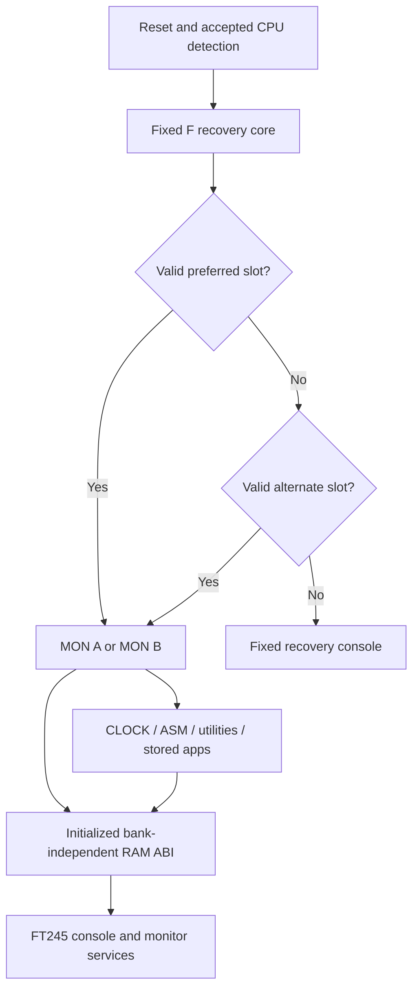
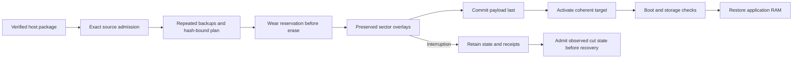
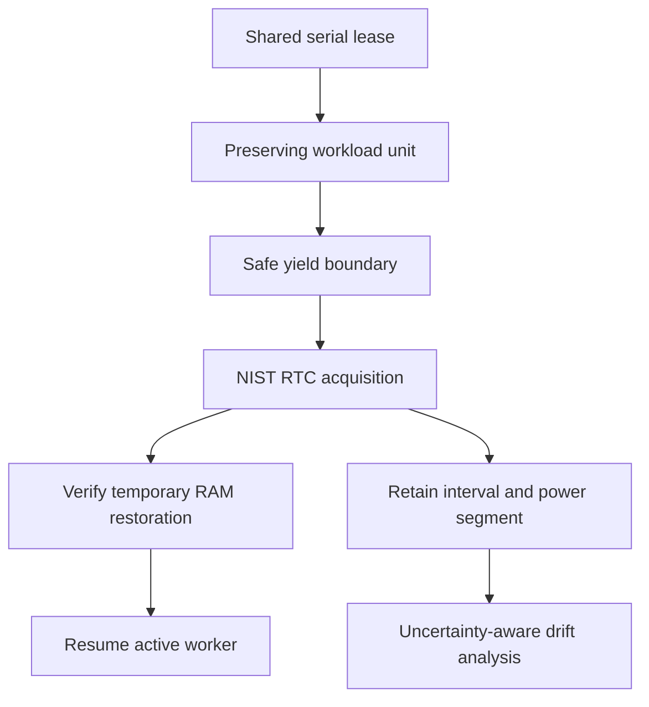

# rc1 technical manual — candidate

Release scope and limitations: [rc1 qualification](README.md#rc1-qualification).

Target: published **2.0rc1 generation 49**, plus the explicitly marked
**DBG1 generation-50 extension**, FT245/F30D. DBG1 has separate 65C02 and
65C816 E=1 model evidence and bounded hardware smoke in both slots on
2604/2609. [Results and limits](DEBUGGER_BOARD_RESULTS.md) distinguish these
from historical migration proofs. Native applications/debugging, electrical
interruption qualification and general route acceptance are outside the DBG1
checkpoint. ACIA, crypto and v2.1 work remain outside this document.

## CPU, banking and memory ownership

The CPU sees RAM below `$7F00`, board I/O at `$7F00–$7FFF`, and the selected
32 KiB flash bank B0–B3 at `$8000–$FFFF`. CPU addresses alone do not identify
flash contents without the selected bank. External SPI SRAM is accessed through
services, rather than directly mapped into the CPU address space.

| CPU bank-zero range | Ownership |
| --- | --- |
| `$0000–$00FF` | Zero page; monitor/private scratch and application ABI scratch have distinct contracts |
| `$0100–$01FF` | CPU stack |
| `$0200–$64FF` | Application RAM when optional services are active |
| `$6500–$66FF` | Optional-service reservation; usable by applications only when discovery permits |
| `$6700–$77FF` | Monitor/journal/staging workspace |
| `$7800–$7BFF` | Monitor worker/private staging |
| `$7C00–$7DFF` | Console lines, state, configuration and discovery |
| `$7E00–$7EFF` | RAM vectors and initialized public ABI |
| `$7F00–$7FFF` | Board I/O |
| `$8000–$FFFF` | Selected flash bank |

At `$7D04`, the `SV` discovery descriptor carries format, flags, a service
pointer and application-end limit. `$7D0C = $FF` reserves `$6500–$66FF` until
reset. Discover capability before accessing the service area: with EDU OFF it
may hold ordinary application bytes. A service failure does not release an
active reservation. Use the discovered limit instead of the public include's
historical `$66FF` constant. Loading utilities/ASM or a RAM installer can
replace application RAM; save/restore ownership must be explicit.

## Public ABI and interrupts

The ROM facade begins with a signature at `$F000`; its calls require the
resident flash bank visible. Initialized RAM ABI signature/descriptor begins
at `$7E60`. Its 13 call entries span `$7E64–$7E88`, allowing calls with any
flash bank selected. Applications must validate format/capabilities and obey
the include contract: IRQ disabled, decimal clear; on 816, E=1, D=0, DBR=0,
PBR=0. These are emulation-mode, non-reentrant calls.

Emulation interrupt pointers begin at `$7E00`, native pointers at `$7E10`.
Native vector support does not advertise native monitor-service calls. Native
handlers, native calls and native debugging are outside this manual's current
qualification scope. Do not overwrite live vectors while another program owns
the machine.

## DBG1 RAM debugging and workspace

Current v1g DBG1 uses B1:`$A000-$AFFF` (3,975 code bytes plus two CRC bytes,
119 free). See [current candidate status](DBG1_CANDIDATE_STATUS.md) for
hardware qualification and the ongoing owner-controlled soak.
B1:`$9000-$9FFF` is unchanged. Matching MON A/B header code automatically
installs the BRK pointer and HOLD cleanup; matching ASM accepts the explicit
signature byte. A complete coherent generation-50 set is required. The
published generation-49 source and release ZIP are unchanged.

| Reserved RAM | DBG1 use |
| --- | --- |
| `$7000-$73FF` | Shared monitor workspace: saved context, scratch, breakpoint records, stack/zero-page images and return trampolines |
| `$7040-$705F` | Eight four-byte user breakpoint records |
| `$7060-$7067` | Two internal stepping records |
| `$7B81-$7B8F` | Automatic BRK entry stub |
| `$7BFC-$7BFF` | Lifecycle state |
| `$7C30-$7C3F` | Four system registrations, 16 bytes |
| `$7C40-$7C7F` | Sixteen user registrations, 64 bytes |

These are existing reserved ranges: application RAM and every ASM buffer
remain unchanged. Entry needs nine free stack bytes. Active debugger sessions
own the shared staging area; private loaders are not application APIs. S/R/T
staging refuses active sessions, and resident flash paths protect B1:A before
mutation without borrowing the sector buffer.

An explicit two-byte `BRK xx` captures application context. Stop signatures
open `DBG>`; `$80-$84` and registered callbacks dispatch against saved context.
PC after an explicit BRK names the following instruction; a patched breakpoint
rewinds PC to the original unexecuted instruction. All patches are removed
while paused. C/S/N rearm persistent records; HOLD/X/reset clean up records
and dynamic registrations. Ordinary instructions execute with a temporary
successor breakpoint; control transfers are emulated against saved state.
N uses return address and stack depth for JSR step-over; user hits interrupt it.
IRQ/NMI timing is not virtualized. The 816 uses only the supported common
instruction subset and preserves hidden accumulator B; native mode is outside scope.

See the [debugger guide](DEBUGGER_GUIDE.md),
[BRK callback ABI](ABI_REFERENCE.md#dbg1-brk-functions-and-registrations) and
[ASM examples](ASM_GUIDE.md#debugging-ram-programs-with-dbg1).

## Persistent layout and configuration

The candidate build pins 19 artifacts, including distinct A and B monitors.
The transaction plan identifies the sector overlays and protected holes; it is
not a blanket erase plan: unowned bytes within the same sector must be preserved.
B1 contains CLOCK storage and ASM pages; B2 contains XIP utilities and smaller
assets. B3 contains RTC/journal code, monitor slots A/B, configuration/wear
journals C/D, and recovery E/F. Mutable service records in B3 `$9C00–$9FFF`
are excluded from owned code ranges. B0, user-program areas, the transaction’s selected fallback,
C/D and holes in B2 are not disposable package padding.

The RAM configuration copy is at `$7D80`, 16 bytes. Its durable source is the
latest valid committed C/D journal record, not a fixed pocket in F. WC records
contain sequence, settings/monitor preference and conservative erase counts;
validity includes format, CRC and commit marker. Monitor preference must name
a committed valid slot with matching generation. Backup manifests and full
bank hashes bind restoration to a specific source; unknown/stale inputs refuse.

## Staged transaction and wear-aware recovery

rc1 uses a separate 585-byte RAM reservation helper that validates A0 or B0
fallback and matching generation. The original beta35 helper remains unchanged.
The composed installer validates all four bank preimages before mutation and
reserves planned erase attempts before its first erase. It then stages the
opposite journal, writes preserved sector overlays, commits payload headers
last and activates only a coherent target.

The inherited bf1 engine has physical shared-CPU and exact-source empty-bank
migration evidence. The rc1 target changes only the monitor identity,
generation and dependent CRCs. Fresh CPU/flash execution covers both full
22-transfer routes, late factory forward recovery, interrupted beta4 forward
recovery and restoration of the captured beta4 payload while retaining newer
wear history. The same common transport is exercised on Windows and Linux
with simulated endpoints; these are software tests, not new hardware installs.

Recovery requires the exact original kit, backup and replayable mutation
lineage. It preserves newer sequences/counts and refuses unknown partial
programming. Complete clean targets produce a no-write receipt. A late failure
does not imply rollback. Early WDC cuts lacking a valid STR8-N fallback/journal
can require an external programmer and the original private source backup.

## RTC, outages and measurement limits

RTC calendar uses the UTC convention; local display uses a saved fixed offset.
Trim changes oscillator correction; offset changes display conversion. Device
identity binding and power-fail history are separate persistent evidence.
Down/up hardware captures are yearless and minute resolution. The inherited shared
duration code anchors the up year, infers a prior year when the down date wraps,
validates calendar fields and reports estimated days/hours/minutes. It cannot
recover seconds, multiple elapsed years or unrecorded outages. Unknown input
must not be turned into a precise duration or lifetime uptime percentage.

Battery policy uses dated retained records; it does not measure voltage.
Backward-date detection can append an uncertainty record at boot/BATTERY.
QA35-006 verifies the expected append on an archived fixture and stable second
boot. Thus a boot/status path is not universally free of persistent effects.

The immutable four-board baseline and each fresh NIST sample retain acquisition
intervals. Propagate baseline and sample uncertainty when computing drift.
Offset ranks are not frequency rankings; a zero-containing rate interval does
not justify a trim change. Powered-off rate requires post-return evidence.

## Qualification boundaries and source

rc1 is a scoped release candidate with source-build, CPU/flash model,
manual/ABI and extracted-platform software verification. Prior bf1 hardware
proofs are retained by version. Subsequent rc1 and DBG1 hardware checks are
recorded separately: [UTC update](../STR8N_RC1_UTC_BOARD_UPDATE_2026-10-18.md)
and [DBG1 results](DEBUGGER_BOARD_RESULTS.md). The debugger trial does not
qualify additional migration routes.
Live migration admits only the exact supported SXB6 WDC source or published
beta4 with erased B0/B1/B2. Native 816 applications/tests, ACIA and crypto are
deferred. RTC qualification and the known continuity issue are deferred.
Soaks and RTC sampling remain stopped; the owner accepted recorded results
without claiming the longer endurance or seven-day RTC gates passed.

Source contracts are in `release/candidates/rc1/source/assembler/str8n-v2-public.inc`,
`core/service-eq.inc` and `core/str8n-v2-eq.inc`; build with the candidate's
`build.py`. See [ABI tables](ABI_REFERENCE.md), [migration/recovery](MIGRATION_RECOVERY.md)
and [image maps](RELEASE_PATHS.md).

The same firmware supports 65C02 and 65C816 emulation-mode runtime. Native
816 applications/testing, ACIA and crypto remain deferred. The existing startup
CPU detector briefly enters native mode before restoring emulation; this
startup exception was explicitly accepted by the owner.

Complete programmer image, bank layout and MON A/MON B naming: full firmware image (repository reference: `STR8N_RC1_FULL_FIRMWARE_IMAGE.md`).

## ABI tables and architecture diagrams

The [ABI reference](ABI_REFERENCE.md) lists all 13 RAM/ROM facade entries,
query results, discovery/configuration fields and versioned S/R/T calls.
The [operator guide](OPERATOR_GUIDE.md) separates prompt contexts and operating
procedures. These Mermaid diagrams describe control and ownership, not timing.

Rendered SVG copies are included for readers without Mermaid support:
[boot and applications](diagrams/boot-and-apps.svg),
[migration and recovery](diagrams/migration-and-recovery.svg), and
[drift collection](diagrams/drift-collection.svg). The drift diagram describes
the collection design; it does not imply that an owner-stopped campaign is active.

## Complete application image and migration scope

The 96 KiB STR8-N-only app image contains CLOCK/ASM, providers/utilities,
MON A/MON B and recovery/core. S/R/T is assembled at B3:`$E800` inside E.
UCHESS has a 1,439-byte executable plus a 24-byte stored-program header at
B1:`$8000`; `T 1` discovers it and `R 1 UCHESS` runs it. Full source and original
license/credits accompany the image. Empty-bank RAM migrations install the same
applications; prior bf1 physical WDC/65C816 and beta4/65C02 checks passed; rc1 is model-tested. Unused image
padding is not permission to overwrite user storage. Public live routes require
erased B0/B1/B2 and refuse unknown sources; see the migration guides.

## Package revision 2: power-fail timezone label

The startup heading is `[power-fail UTC]`. Power-down/up timestamps are raw
UTC with minute precision; the separate RTCC line uses the configured display
offset. For example, October 18 04:35 UTC is October 17 23:35 at -05:00.
Only banner text, its data references and the sector checksum changed. Clock/trim values, event
handling, apps and migration/recovery algorithms are unchanged. The corrected
revision was verified offline and subsequently installed/device-verified on
both boards. DBG1 retains that correction.
